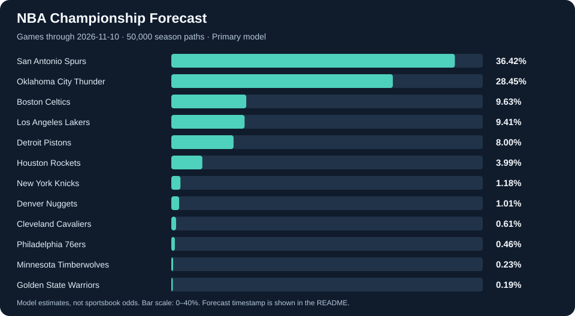

# NBA Champion Forecasting

[Explore the interactive dashboard](https://nba-champion-forecasting-dqxpvfhd8s7cpt8mmqkzna.streamlit.app/)

[](https://github.com/EntropicBromberg/nba-champion-forecasting/actions/workflows/tests.yml)

As a long-time basketball fan and lover of basketball analytics, I wanted to understand championship contention beyond standings and narratives. This project brings that interest together with probability, statistics, mathematical modeling, and quantitative analysis: estimating how team strength translates into a path through the season and playoffs.

**Python · XGBoost · Monte Carlo simulation · Streamlit**

## Championship probabilities

<!-- FORECAST:START -->
**Latest successful primary forecast** · Games through **2026-11-08** · Refreshed **2026-11-09 23:58 UTC**



<details>
<summary>All 30 teams</summary>

| Team | Championship probability |
|---|---:|
| Oklahoma City Thunder | 44.05% |
| San Antonio Spurs | 24.05% |
| Los Angeles Lakers | 8.74% |
| Detroit Pistons | 7.81% |
| Boston Celtics | 6.18% |
| New York Knicks | 2.38% |
| Houston Rockets | 1.84% |
| Denver Nuggets | 1.70% |
| Cleveland Cavaliers | 1.42% |
| Philadelphia 76ers | 0.78% |
| Minnesota Timberwolves | 0.56% |
| Golden State Warriors | 0.16% |
| Miami Heat | 0.16% |
| Portland Trail Blazers | 0.05% |
| Toronto Raptors | 0.05% |
| Atlanta Hawks | 0.04% |
| Charlotte Hornets | 0.01% |
| Orlando Magic | 0.01% |
| Los Angeles Clippers | 0.00% |
| Brooklyn Nets | 0.00% |
| Chicago Bulls | 0.00% |
| Dallas Mavericks | 0.00% |
| Indiana Pacers | 0.00% |
| Memphis Grizzlies | 0.00% |
| Milwaukee Bucks | 0.00% |
| New Orleans Pelicans | 0.00% |
| Phoenix Suns | 0.00% |
| Sacramento Kings | 0.00% |
| Utah Jazz | 0.00% |
| Washington Wizards | 0.00% |

</details>

Daily refresh is scheduled. The timestamp above advances only after a successful rebuild; this is not a real-time feed. A displayed 0.00% may reflect simulation sampling.
<!-- FORECAST:END -->

## Approach

Regular-season team and player statistics become matchup features for a playoff-series classifier. Symmetric series probabilities feed 50,000 simulations of the remaining regular season, play-in tournament, and playoff bracket. All 30 teams can qualify.

The model uses 25 completed seasons, including team strength, star performance, roster depth, form, and availability. Injury and persistent-strength uncertainty scenarios are separate experiments with explicit assumptions.

## Evaluation

Chronological walk-forward validation covers **225 held-out series across 15 seasons**. Feature selection stays inside each training window, and bootstrap intervals resample whole seasons.

| Model | Accuracy | Log loss ↓ | Brier score ↓ |
|---|---:|---:|---:|
| XGBoost | 71.1% | 0.5865 | 0.1984 |
| SRS logistic baseline | 69.3% | 0.5655 | 0.1927 |

Higher accuracy did not mean better probability estimates: the logistic baseline had better probability scores. These series-level results do not establish calibrated early-season championship odds. [Evaluation summary](reports/evaluation_summary.json).

## What I learned

The most valuable lessons came from separating observed injuries from assumed player impact and recovery; preventing leakage in features and validation; recognizing backfitting when revisiting historical results; and distinguishing simulation noise from uncertainty in the model itself. More complexity needs stronger evidence, not just a more convincing narrative.

## Run locally

```bash
python -m pip install -r requirements.txt
python -m streamlit run app.py
```

The app displays real primary-model probabilities and clearly labeled experimental variations. Full model training and data acquisition are described in [setup](docs/SETUP.md); raw datasets and fitted models are not bundled. An optional synthetic example remains in `demo.py`.

```bash
python -m unittest discover -s tests -v
```

[Methodology](docs/METHODOLOGY.md) · [Development timeline](docs/DEVELOPMENT.md) · [Data sources](docs/DATA_AND_ARTIFACTS.md)

## Acknowledgment

Inspired by [osmanmm-hub/nba-champion-predictor](https://github.com/osmanmm-hub/nba-champion-predictor). Development began from its checkout; this version substantially rebuilds the data pipeline, forecasting methodology, simulation, and dashboard, with Codex assistance.

[MIT License](LICENSE) applies to this project's original code and documentation. Third-party data, libraries, and trademarks retain their respective rights.
